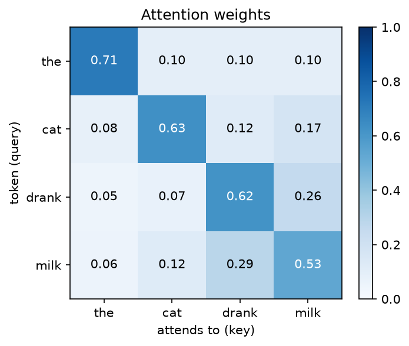
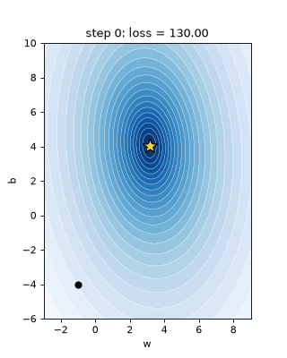
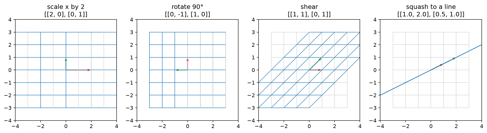
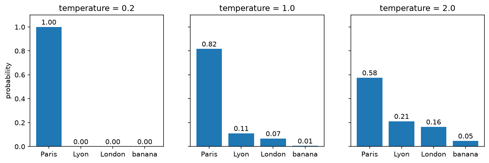
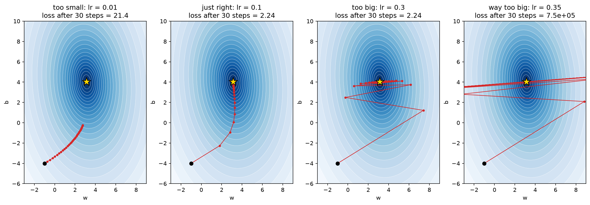

# Math for LLM

The math behind LLMs, built from scratch in two Jupyter notebooks:
how a model computes (vectors up to a mini attention mechanism) and how it learns (gradient descent).
Every function is written by hand in plain Python and checked against NumPy with `np.allclose`.

| Notebook | Question it answers |
|---|---|
| [`math-for-llm.ipynb`](math-for-llm.ipynb) | How does an LLM compute? Vectors, dot products, matrices, softmax, attention |
| [`gradient-descent.ipynb`](gradient-descent.ipynb) | How does a model learn? Loss, gradient, chain rule, learning rate |





## What's inside

| Topic | Built from scratch | Why it matters for LLMs |
|---|---|---|
| Vectors & embeddings | `magnitude`, `normalize`, king − man + woman | Text is represented as vectors |
| Dot product & cosine | `dot_product`, `cosine_similarity`, mini semantic search | How RAG retrieves relevant documents |
| Matrices | `matmul`, grid transformations, AB ≠ BA | Every LLM layer is a matrix multiplication |
| Probability | Bayes, `softmax`, temperature sampling | How the next token is chosen |
| Mini attention | `softmax(QKᵀ/√d)·V`, causal mask | The core of the Transformer |
| Loss & gradient | `mse`, numerical gradient, chain rule gradient | Backpropagation is the chain rule applied layer by layer |
| Gradient descent | `gradient_descent`, loss landscape, checked against least squares | The same loop trains and fine-tunes every LLM |
| Learning rate | Too small, just right, too big, diverging | Why a training loss curve crawls or explodes |







## Run it

```bash
git clone https://github.com/kardi06/math-for-llm.git
pip install -r math-for-llm/requirements.txt
jupyter notebook math-for-llm/
```

Tip: create a virtual environment first (`python -m venv .venv`) to keep the packages isolated.
